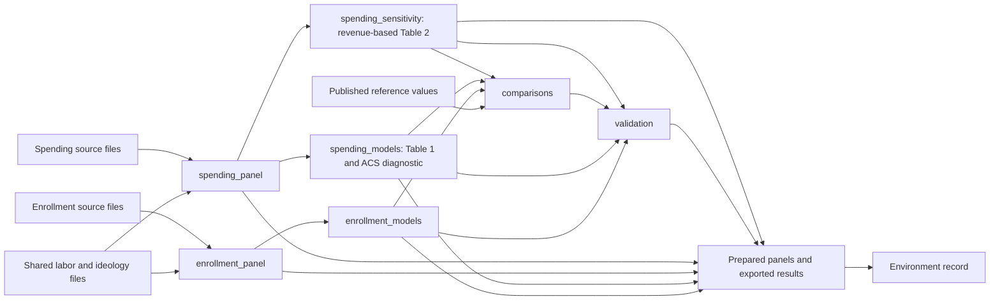
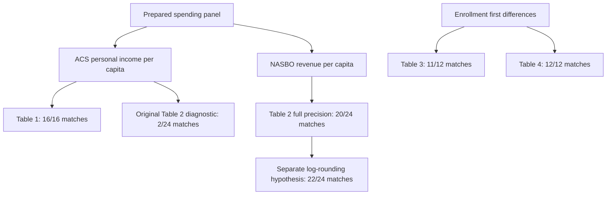

# How the workflow fits together

`_targets.R` is the central workflow file. It loads methods from `src/` via `scripts/load_modules.R`, then declares named targets and their dependencies. The statistical methods stay in the existing functions; the workflow specifies when they run and how their results flow between steps.

The actual workflow has 17 targets:

| Targets | Role |
| --- | --- |
| `shared_source_files`, `spending_source_files`, `enrollment_source_files` | Track the exact raw files read by the preparation functions |
| `reference_file`, `published_targets` | Track and read the published comparison values |
| `spending_panel`, `enrollment_panel` | Prepare data independently |
| `spending_models`, `spending_sensitivity`, `enrollment_models` | Fit Table 1/ACS diagnostic, the revenue-based Table 2 reconstruction, and enrollment models |
| `comparisons`, `validation` | Compare with the paper and run consistency checks |
| `prepared_panel_files`, `analysis_files`, `comparison_files`, `reconciliation_files` | Write and track validated outputs |
| `environment_files` | Record the environment after the analysis/comparison exports exist |

The preparation commands explicitly reference their source-file targets because the underlying readers accept a directory. Those references are essential: tracking the directory name alone would not detect edits to file contents. Shared labor and ideology changes invalidate both examples. Enrollment-only input changes invalidate the enrollment branch; changes to the reference table affect comparison/validation and downstream exports without refitting models.

## How the tables map to the models

The overview above groups the export targets; the generated interactive graph shows all 17 targets individually. The scientific distinction between the two spending constructions is:

Counts compare cells at their published precision; they do not imply every model assumption is verified. The Table 2 reporting path changes only the percent-effect presentation. The two p-values and the Table 3 effect-entry discrepancy remain documented in the [audit](../reference/replication-audit.md).

## Commands and caching

The existing shell command, `Rscript --vanilla scripts/run_replication.R`, resolves the repository root and calls `targets::tar_make()`. In an R session at the root, `targets::tar_make()` does the same work. `targets::tar_read(spending_models)` retrieves a cached result; its list contains the Table 1 fitted models and original ACS-based sensitivity diagnostic. `targets::tar_read(spending_sensitivity)` retrieves the distinct revenue model, analytic panel, full-precision bounds, and reporting reconstruction for Table 2.

`targets::tar_visnetwork(targets_only = TRUE)` displays the dependency graph. `Rscript --vanilla scripts/run_replication.R graph` saves an interactive HTML version. `targets::tar_outdated()` lists steps that need rebuilding.

Targets caches intermediate objects in the ignored `_targets/` directory and skips current work. All generated analysis files are returned by file targets, so missing or edited exports are detected. Exports are currently grouped: deleting one table regenerates the analysis export group, while cached model fits are reused. The reconciliation exports form a separate group, so deleting a reporting output also reuses all cached model fits.

Installed package versions and R are recorded with the exports but do not automatically invalidate cached calculations. After an environment change, invalidate and rerun the workflow; the renv lockfile and R version pin define the supported environment. Use `targets::tar_invalidate(names = tidyselect::everything())` before rebuilding after an environment change. If you copy or relocate the repository, discard the old `_targets/` cache and rebuild, because file targets contain paths.

## Regression checks and optional work

`src/run_replication.R` retains an uncached function for debugging and the independent exact regression check. Both orchestrators call the same preparation, modeling, validation, and export functions. `tests/check_regression.R` checks both the original ACS 18-file/seven-model contract and the default revenue reconstruction against independent archival evidence. `tests/check_workflow.R` verifies both contracts in the cached workflow: original ACS values are checked through their labeled diagnostic exports, while the primary Table 2 output is checked against revenue evidence. It also tests cache and file behavior.

The exploratory spending-bounds diagnostics remain a separate command. They are not part of the default graph, so speculative variants do not become dependencies of the published-table replication.

For isolated workflow tests or alternate export destinations, `_targets.R` reads `DID_RAW_DIR`, `DID_DERIVED_DIR`, `DID_OUTPUT_DIR`, and `DID_REFERENCE_FILE`. Normal use needs none of these variables. They change paths only, not the analysis specifications.

The single command entry point accepts `setup`, `run` (the default), `graph`, `check`, and `diagnose`. Optional specification-search functions are loaded only by research commands or their regression checks. `scripts/activate_environment.R` remains separate because `.Rprofile`, the command entry point, and fresh test processes all need to activate the same pinned environment before loading analysis dependencies.
